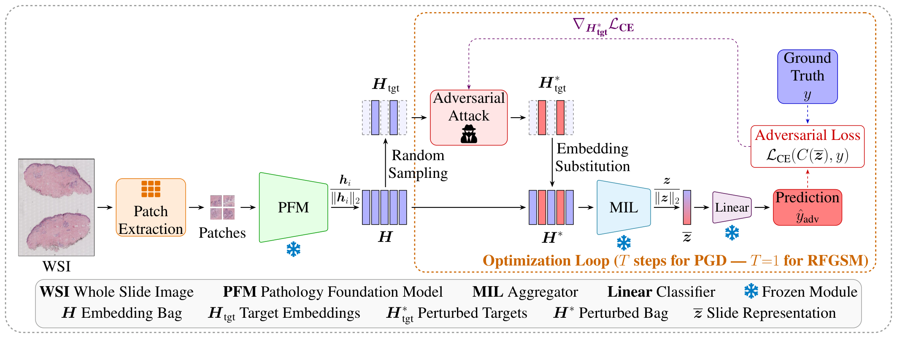

<h1 align="center">🕵️ Attacking the Feature Space:<br>Adversarial Vulnerabilities of Pathology Foundation Models<br>in Whole Slide Image Classification</h1>

<p align="center">Vasil Damyanov, Ilán Carretero, Pablo Meseguer, Valery Naranjo, Rocío del Amor</p>
<p align="center"><b>Submitted to ISBI'27</b></p>

<br>

<div align="center">
    
</div>

---

### TL;DR

<p align="justify">
Computational pathology pipelines encode image patches with pathology foundation models (PFMs) and aggregate their embeddings into slide-level predictions through multiple instance learning (MIL). Although PFMs have proven vulnerable to pixel-space attacks, the robustness of their precomputed embeddings to adversarial manipulations remains largely unexplored. We address this gap by perturbing stored embeddings directly, bypassing the encoder. Specifically, we adapt the Randomized Fast Gradient Sign Method (RFGSM) and Projected Gradient Descent (PGD) within an L<sub>2</sub>-bounded white-box framework that perturbs a fraction of unit-normalized patch embeddings, making perturbation budgets comparable across PFMs. We evaluate six PFMs with two MIL aggregators on AI4SkIN, a dataset of cutaneous spindle cell neoplasms. Averaged over PFMs, aggregators, and attack configurations, balanced accuracy drops by 23.8 percentage points, whereas random perturbations with matched budgets have little effect. Even small but well-directed perturbations to a fraction of patch embeddings can substantially degrade slide-level performance.
</p>

---

## Table of Contents

- [Repository Structure](#repository-structure)
- [Setup](#setup)
  - [Docker (Recommended)](#option-a-docker-recommended)
  - [Conda](#option-b-conda)
- [Data](#data)
- [Running Experiments](#running-experiments)
  - [Command-Line Arguments](#command-line-arguments)
  - [Example Usage](#example-usage)
- [Output Structure](#output-structure)

---

## Repository Structure

```
pfm-embedding-attacks/
├── train.py                 # Trains ABMIL and TransMIL on the embeddings of one PFM
├── attack.py                # Runs Random, RFGSM and PGD over the (ε, ρ) grid on the test set
├── requirements.txt         # Python dependencies
├── README.md                # This file
├── assets/                  # Figures for the README
├── src/
│   ├── attacks.py           # L2-bounded attacks on unit-normalized embeddings
│   ├── data.py              # Split loading and L2 normalization of the patch embeddings
│   ├── utils.py             # Seeds, slide-level metrics, embedding distortion
│   └── models/
│       ├── abmil.py         # ABMIL with gated attention
│       └── transmil.py      # TransMIL with Nyström attention and PPEG
└── data/AI4SKIN/
    ├── splits/              # Train/val/test partitions used in the paper
    └── embeddings/          # Patch embeddings go here (not distributed)
```

---

## Setup

### Option A: Docker (Recommended)

We provide a Docker-based workflow using the NVIDIA PyTorch container, which bundles all major dependencies (PyTorch, torchvision, CUDA).

1. **Pull and run the container**, mounting the repository and the folder with the embeddings:

```bash
docker run \
  --name pfm-attacks \
  --gpus '"device=0"' \
  --ipc=host \
  -it --rm \
  -v /path/to/pfm-embedding-attacks:/workspace/pfm-embedding-attacks \
  -v /path/to/embeddings:/workspace/pfm-embedding-attacks/data/AI4SKIN/embeddings \
  -w /workspace/pfm-embedding-attacks \
  nvcr.io/nvidia/pytorch:23.10-py3
```

> **Note:** Replace `/path/to/pfm-embedding-attacks` with the absolute path to the cloned repository, and `/path/to/embeddings` with the folder that holds one subfolder per PFM (see [Data](#data)).

2. **Install the remaining dependencies** inside the container:

```bash
pip install -r requirements.txt
```

### Option B: Conda

```bash
conda create --name pfm-attacks python=3.10 -y
conda activate pfm-attacks
pip install -r requirements.txt
```

---

## Data

We use a six-class subset of the public AI4SkIN dataset of cutaneous spindle cell neoplasms (del Amor et al., *Scientific Data*, 2025), with 626 WSIs:

| Class | `subtype` | `GT` | WSIs |
|-------|-----------|------|------|
| Leiomyoma | `lm` | 0 | 104 |
| Leiomyosarcoma | `lms` | 1 | 46 |
| Dermatofibroma | `df` | 2 | 195 |
| Dermatofibrosarcoma | `dfs` | 3 | 57 |
| Spindle cell melanoma | `scm` | 4 | 122 |
| Atypical fibroxanthoma | `afx` | 5 | 102 |

### Splits

[`data/AI4SKIN/splits/`](data/AI4SKIN/splits) holds the class-stratified, patient-level partition of the paper: 448 training, 91 validation and 87 test WSIs, with no patient shared between splits.

### Embeddings

Patch extraction and feature encoding are not part of this repository. In the paper, each WSI is tiled into non-overlapping 512 × 512 pixel patches at 10× magnification, and every patch is encoded with each PFM. Each WSI must be stored as a float32 array of shape `[N, d]`, one row per patch, in a folder named after the PFM:

```
data/AI4SKIN/embeddings/
├── CONCH/
│   ├── AI4SKIN_HCUV_002_A.npy
│   └── ...
├── KEEP/
└── ...
```

File names must match the `WSI` column of the split files. The embeddings can also live elsewhere if you pass `--embeddings_root /path/to/embeddings`. The six PFMs of the paper:

| PFM | `--pfm` | d |
|-----|---------|---|
| CONCH | `CONCH` | 512 |
| KEEP | `KEEP` | 768 |
| GPFM | `GPFM` | 1024 |
| KAIKO | `KAIKO` | 1024 |
| Virchow2 | `VIRCHOW2` | 1280 |
| UNI2 | `UNI2` | 1536 |

---

## Running Experiments

### Command-Line Arguments

Default paths are relative to the repository, so both scripts can be run from any directory.

**`train.py`**

| Argument | Type | Default | Description |
|----------|------|---------|-------------|
| `--pfm` | str | required | PFM of the embeddings: `CONCH`, `KEEP`, `GPFM`, `KAIKO`, `VIRCHOW2` or `UNI2` |
| `--aggregators` | str list | `ABMIL TransMIL` | Aggregators to train |
| `--embeddings_root` | str | `data/AI4SKIN/embeddings` | Folder with one subfolder of `<WSI>.npy` files per PFM |
| `--splits_dir` | str | `data/AI4SKIN/splits` | Folder with `train.csv`, `val.csv` and `test.csv` |
| `--output_dir` | str | `results` | Directory to save all outputs |
| `--epochs` | int | `20` | Number of training epochs |
| `--lr` | float | `1e-4` | Learning rate of AdamW |
| `--weight_decay` | float | `1e-5` | Weight decay of AdamW |
| `--seed` | int | `42` | Random seed |

**`attack.py`**

| Argument | Type | Default | Description |
|----------|------|---------|-------------|
| `--pfm` | str | required | PFM of the embeddings |
| `--aggregators` | str list | `ABMIL TransMIL` | Aggregators to attack |
| `--attacks` | str list | `RANDOM RFGSM PGD` | Attacks to run |
| `--epsilons` | float list | `0.01 0.05 0.1 0.15 0.2 0.25 0.5` | Per-patch L2 budgets ε |
| `--ratios` | float list | `0.01 0.05 0.1 0.25 0.5 1` | Fractions ρ of patches to perturb |
| `--steps` | int | `10` | PGD iterations |
| `--embeddings_root` | str | `data/AI4SKIN/embeddings` | Folder with one subfolder of `<WSI>.npy` files per PFM |
| `--splits_dir` | str | `data/AI4SKIN/splits` | Folder with the split files |
| `--output_dir` | str | `results` | Directory with the trained models and where the results are saved |
| `--seed` | int | `42` | Base seed of the patch selection and the random starts |

### Example Usage

**Train both aggregators on CONCH:**
```bash
python train.py --pfm CONCH
```

**Attack the test set over the full grid of the paper:**
```bash
python attack.py --pfm CONCH
```

**Run a single configuration:**
```bash
python attack.py --pfm UNI2 --aggregators TransMIL --attacks PGD --epsilons 0.15 --ratios 0.1
```

> **Note:** Each run rewrites `results/attacks/<PFM>_<aggregator>.csv`, so a narrower run replaces the file of the full grid. Rename the file first if you want to keep it.

**Reproduce all the experiments of the paper:**
```bash
for pfm in CONCH KEEP GPFM KAIKO VIRCHOW2 UNI2; do
    python train.py --pfm $pfm
    python attack.py --pfm $pfm
done
```

---

## Output Structure

All outputs are saved under `--output_dir` (default: `results/`), with one folder and one CSV per PFM and aggregator (e.g. `CONCH_ABMIL`):

```
results/
├── models/
│   └── <PFM>_<aggregator>/
│       ├── model.pth              # Weights of the epoch with the lowest validation loss
│       ├── history.csv            # Training and validation loss/accuracy per epoch
│       └── metrics.csv            # Validation and test metrics of the selected checkpoint
└── attacks/
    └── <PFM>_<aggregator>.csv     # One row per (attack, ε, ρ), plus the clean baseline
```

Columns of each attack CSV (metrics are stored as fractions):

| Column | Contents |
|--------|----------|
| `PFM`, `Dim`, `Aggregator` | Embeddings and model that were attacked |
| `Attack`, `Epsilon`, `Ratio`, `Steps` | Attack configuration (`Steps` is 10 for PGD, 1 for RFGSM and 0 for Random) |
| `ACC`, `BACC`, `F1`, `AUC` | Slide-level metrics on the attacked test set |
| `BACC_Drop` | Clean BACC minus attacked BACC |
| `ASR` | Fraction of correctly classified WSIs whose prediction the attack changes |
| `L2_Dist`, `Cos_Sim`, `Feat_Diff` | Distortion of the targeted embeddings |
| `Time_s` | Running time of the configuration, in seconds |
